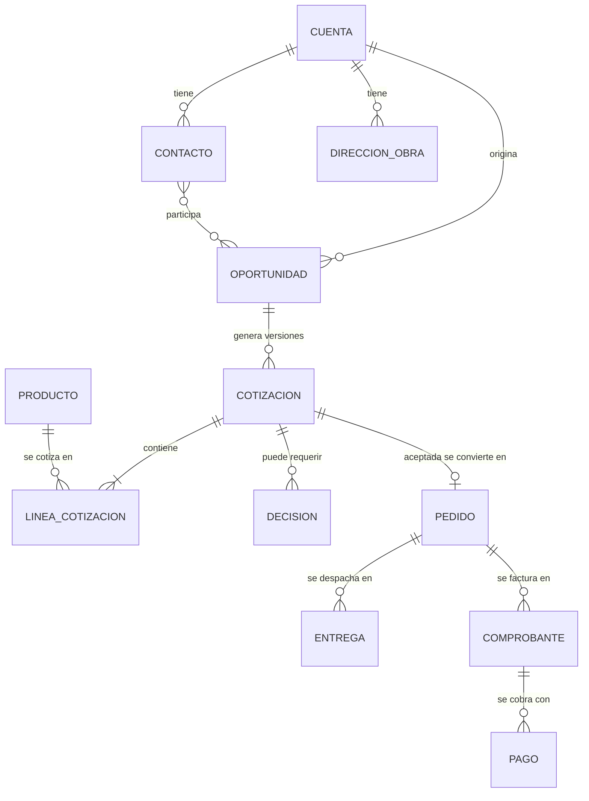

# Datos

Esta carpeta documenta los datos que permiten integrar y reconstruir los procesos de Ferre & Inversiones MIGAL: qué significan, quién los mantiene, qué reglas de calidad cumplen, cómo se protegen y cómo se rastrea una operación entre el CRM, el ERP y KeyFacil.

## Contenido

| Archivo / carpeta | Contenido |
|---|---|
| [`diccionario-datos.md`](diccionario-datos.md) | **Única fuente** de definiciones: campos y objetos transaccionales |
| [`reglas-calidad.md`](reglas-calidad.md) | Reglas de calidad DQ-01 a DQ-12 |
| [`tratamiento-datos.md`](tratamiento-datos.md) | Finalidad, minimización y uso operativo frente a promocional |
| [`plantilla-entidad.md`](plantilla-entidad.md) | Plantilla para documentar cada entidad maestra |
| [`maestros/`](maestros/) | [Clientes](maestros/clientes.md), [productos](maestros/productos.md), [precios](maestros/precios.md) y [proveedores](maestros/proveedores.md) |
| [`trazabilidad/`](trazabilidad/README.md) | Prefijos de identificadores, plan de trazabilidad y auditoría, y su matriz en Excel |
| [`pruebas/`](pruebas/README.md) | Catálogo sintético CRM usado en los casos de prueba |

## Modelo conceptual

Relación entre las entidades principales. Las de la parte inferior (pedido en adelante) pertenecen al ERP y aún no tienen datos de prueba.

## Convenciones

* **Identificadores y códigos:** los prefijos de entidad (CLI, OPP, COT…) están en el [registro de identificadores](trazabilidad/identificadores-y-linaje.md); los códigos de reglas y documentos (RN, CT, DQ, TR…), en la [guía de contribución](../CONTRIBUTING.md#13-códigos-e-identificadores).
* **Caso de ejemplo único:** los documentos usan los IDs del [catálogo sintético](pruebas/README.md): el caso normal es `OPP-SIM-001` / `COT-SIM-001-V01` y el caso de excepción es `OPP-SIM-002` / `COT-SIM-002-V02`.
* **Responsables:** se indican con los perfiles del [modelo de autorización](../arquitectura/seguridad/modelo-autorizacion.md). La custodia de los datos maestros corresponde a R-PRO.
* **Etiquetas de evidencia:**

| Etiqueta | Significado |
|---|---|
| `[E]` | Evidencia respaldada por una fuente del negocio |
| `[I]` | Interpretación razonada a partir de evidencia |
| `[S]` | Supuesto provisional pendiente de validación |
| `[ND]` | No determinado: no hay información suficiente |
| `AS-IS` / `TO-BE` | Situación actual / mejora propuesta |
| `[SIM]` | Dato ficticio, solo para pruebas |

## Reglas

- No subir credenciales, secretos ni datos personales reales.
- No presentar datos simulados como información real de la empresa; todo dato de prueba lleva el sufijo `-SIM` o la etiqueta `[SIM]`.
- Los cambios en maestros o reglas de calidad se revisan contra procesos, arquitectura y pruebas.
