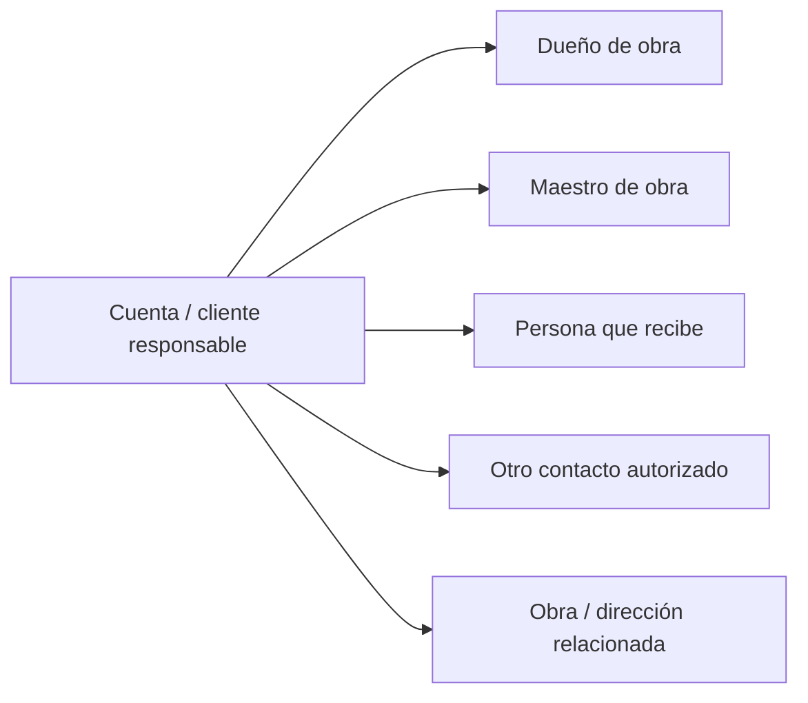

# Cuenta, contacto, canales y contexto comercial del cliente

**Proyecto:** Ferre & Inversiones MIGAL  
**Curso:** GE703 · Sistemas Integrados Empresariales  
**Alcance:** contexto CRM previo al pedido confirmado

## 1. Propósito

Definir qué contexto mínimo necesita conservar MIGAL para reconocer al cliente, comprender quién participa en una compra, recuperar el historial comercial y dar seguimiento a una oportunidad sin depender exclusivamente de la memoria de los propietarios o de conversaciones dispersas.

Este documento **no diseña un modelo físico de datos**. Adapta al caso MIGAL los conceptos de cuenta, contacto, canal, consentimiento y dirección presentados en la sesión 6 y en los catálogos docentes.

## 2. Situación actual de MIGAL

### 2.1. Identificación del cliente

- `[E][AS-IS]` En una cotización puede registrarse el nombre del cliente, pero no siempre se hace. En algunos casos la nota contiene principalmente productos, cantidades y precios. `[FN-01][FN-02]`
- `[E][AS-IS]` Información como nombre de la obra, dirección, responsables o antecedentes de atención puede permanecer en la memoria de los propietarios o en conversaciones de WhatsApp. `[FN-02]`
- `[E][AS-IS]` Los clientes habituales o aquellos que requieren coordinación frecuente suelen guardarse como contactos; sin embargo, no existe una nomenclatura estándar que permita reconocer rápidamente a qué cliente u obra pertenece cada número. `[FN-02]`
- `[E][AS-IS]` Históricamente, los celulares usados para el negocio han mezclado información comercial y personal. Los propietarios vienen intentando separar ambos usos. `[FN-02]`

### 2.2. Cliente responsable y maestro de obra

`[E][AS-IS]` En una venta para obra pueden intervenir al menos dos actores:

- **Cliente responsable / dueño de obra:** normalmente paga o autoriza la compra y debe conocer el costo de los materiales.
- **Maestro de obra:** puede preparar la lista, recomendar productos, negociar condiciones, coordinar requerimientos y recibir materiales.

En algunos casos el dueño delega casi completamente la adquisición al maestro de obra. Por ello, la relación no debe modelarse suponiendo que siempre existe un único interlocutor. `[FN-01][FN-02]`

## 3. Propuesta de organización en CRM

### 3.1. Cuenta

`[TO-BE]` La **cuenta** representa al cliente responsable de la relación comercial. Puede ser una persona natural, una empresa o el responsable económico de una obra.

Información mínima propuesta:

| Información | Propósito de uso | Actualización propuesta |
|---|---|---|
| Identificador interno | Evitar confundir clientes con nombres similares | Se asigna una vez |
| Nombre / razón social | Reconocer al cliente | Cuando el cliente comunica un cambio |
| Tipo de cliente | Distinguir atención minorista y compras vinculadas a obra | Cuando cambia el contexto principal |
| DNI/RUC, si corresponde | Apoyar identificación y futura condición de comprobante | Solo cuando sea necesario para la operación |
| Responsable comercial | Saber quién da seguimiento | Al reasignar la atención |
| Estado de relación | Distinguir cliente activo/inactivo | Cuando deja de ser vigente |

`[I][TO-BE]` No se propone exigir DNI/RUC para registrar un primer interés o elaborar necesariamente una cotización, porque la práctica actual de MIGAL no respalda que sea un requisito universal.

### 3.2. Contactos relacionados

Una cuenta puede tener más de un contacto:

Información mínima propuesta para el contacto:

| Información | Propósito |
|---|---|
| Nombre | Identificar al interlocutor |
| Rol | Distinguir dueño, maestro, receptor u otro |
| Teléfono | Comunicación operativa |
| Canal preferido | Evitar depender de recordar cómo contactarlo |
| Cuenta relacionada | Mantener contexto de quién representa |
| Estado del contacto | No usar referencias que ya no sean vigentes |

## 4. Obra y direcciones

`[E][AS-IS]` Una dirección de obra puede recibirse como texto por WhatsApp, ubicación compartida, referencia verbal o quedar conocida por repetición y memoria. `[FN-02]`

`[TO-BE]` Se propone conservar la dirección como información reutilizable asociada al cliente y, cuando corresponda, a una obra concreta.

Información mínima:

- nombre o referencia de la obra;
- dirección textual;
- ubicación compartida o referencia complementaria;
- distrito;
- indicaciones relevantes para llegar;
- estado de la dirección: activa/inactiva.

`[I][TO-BE]` Una misma cuenta puede necesitar varias direcciones, porque un cliente puede tener más de una obra o destino de entrega.

## 5. Canales y fuente comercial

### 5.1. Canales reales identificados

- `[E][AS-IS]` Presencial / mostrador. `[FN-01]`
- `[E][AS-IS]` WhatsApp. `[FN-01][FN-02]`
- `[E][AS-IS]` Llamadas telefónicas. `[FN-01][FN-02]`
- `[E][AS-IS]` Recomendación o referido, especialmente mediante maestros de obra y clientes conocidos. `[FN-01][FN-02]`

### 5.2. Campañas

`[E][AS-IS]` MIGAL no desarrolla actualmente campañas directas y sistemáticas sobre una base de contactos. Actividades como aniversarios o chocolatadas pueden difundirse mediante estados de WhatsApp; determinadas campañas de Progresol se comunican mediante material físico en el establecimiento. `[FN-02]`

Por ello:

- **canal** indica por dónde se produjo la interacción;
- **fuente** indica cómo llegó el cliente (por ejemplo, referido por maestro);
- **campaña** solo se registra cuando exista una campaña identificable.

No se propone inventar campañas para llenar el CRM.

### 5.3. Catálogo de campañas

`[TO-BE]` Para MIGAL, una **campaña** es una iniciativa identificable, con nombre, periodo, objetivo y responsable, que puede motivar una consulta o reforzar la relación con clientes y maestros. Se modela como un catálogo corto; la mayoría de oportunidades no tendrá campaña.

| ID | Campaña | Objetivo | Periodo | Responsable | Clasificación |
|---|---|---|---|---|---|
| `CAM-01` | Material promocional de Progresol en la tienda | Captación asociada al cemento | Según campaña del proveedor | Propietarios / Progresol | `[E][AS-IS]` `[FN-02]` |
| `CAM-02` | Actividad comunitaria difundida por estados de WhatsApp (aniversario, chocolatada) | Relación con la comunidad | Fecha de la actividad | Propietarios | `[E][AS-IS]` `[FN-02]` |
| `CAM-03` | Fidelización navideña: canastas de víveres y sorteo de herramientas para maestros y clientes | Fidelización y referidos | Diciembre | Propietarios | `[E][AS-IS]` (confirmado por el equipo, 16/10/2026) |
| `CAM-04` | Volanteo en zonas cercanas | Captación geográfica y medición de cobertura de reparto | Por definir | Propietarios | `[S][TO-BE]` propuesta, no práctica actual |

`[I]` `CAM-04` se mantiene como propuesta porque permitiría conocer desde qué zonas llegan los clientes y apoyar la definición de un radio de reparto, que hoy no existe formalmente.

### 5.4. Canal, fuente y campaña: regla de registro

| Concepto | Pregunta que responde | Valores | ¿Obligatorio? |
|---|---|---|---|
| Canal | ¿Por dónde llegó la interacción? | Presencial, WhatsApp, Teléfono | Sí, en cada interacción |
| Fuente | ¿Quién o qué trajo al cliente? | Referido maestro, Referido cliente, Cliente frecuente, Directo | Al conocerla |
| Campaña | ¿Qué iniciativa de MIGAL lo motivó directamente? | `CAM-01` a `CAM-04` o vacío | Solo si el cliente la menciona o la relación es evidente |

`[TO-BE]` Reglas:

- La campaña se registra solo cuando **causó** la consulta, no cuando solo la **favoreció**. Ejemplo: un maestro que recibió una canasta navideña (`CAM-03`) trae en enero a un cliente nuevo → fuente: *Referido maestro*; campaña: vacía. La canasta fortaleció la relación, pero no originó la consulta.
- Si un cliente dice que llegó por el material de Progresol en tienda, se registra `CAM-01`.
- El envío de mensajes promocionales por una campaña requiere consentimiento promocional (ver sección 7 y [`tratamiento-datos.md`](../../datos/tratamiento-datos.md)).
- `[ND]` No existe control del presupuesto ni del retorno de las campañas; registrar la campaña es el primer paso para medirlo.

## 6. Seguimiento comercial

`[E][AS-IS]` Actualmente no existe un mecanismo uniforme para recordar qué cotizaciones requieren seguimiento. `[FN-02]`

`[TO-BE]` Cada oportunidad o cotización abierta puede registrar una **próxima acción**, una fecha y un responsable.

Ejemplos:

- escribir para confirmar si revisó la cotización;
- llamar para conocer si continúa interesado;
- verificar una nueva referencia de precio;
- confirmar si el dueño de obra aprobó la propuesta.

No se fija una frecuencia artificial como “cada 48 horas”; la acción debe responder al contexto de la oportunidad.

## 7. Uso operativo y uso promocional del contacto

La diferencia entre uso operativo y promocional, y la regla de no inferir consentimiento por tener el teléfono del cliente, están en [tratamiento de datos](../../datos/tratamiento-datos.md#4-uso-operativo-vs-promocional).

## 8. Límites

- `[ND]` No existe una política formal documentada de retención de información de contactos.
- `[ND]` No se ha definido un procedimiento formal de consentimiento promocional.
- `[TO-BE]` La ficha CRM propuesta debe validarse con los propietarios antes de considerarse una política del negocio.
- No se diseñan tablas, APIs ni sincronización técnica CRM–ERP; los campos están en el [diccionario de datos](../../datos/diccionario-datos.md).

## 9. Fuentes relacionadas

- `[FN-01]` Monografía SI704V de MIGAL, 15/10/2026.
- `[FN-02]` Aclaraciones de campo registradas por Brenda con base en la operación familiar de MIGAL, 16/10/2026.
- `[FC-01]` Sesión 6 GE703 · CRM, marketing y ventas.
- `[FD-01]` Catálogos docentes GE703 S6, usados como referencia conceptual; sus datos son sintéticos.
