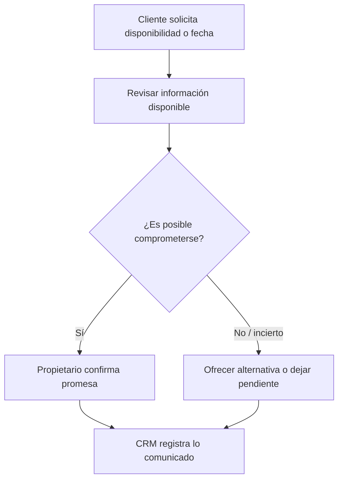

# Decisiones comerciales y responsabilidades

## Metadatos

* **Fecha:** 17/10/2026
* **Versión:** 0.1
* **Autores:** Alejandro Flores
* **Alcance:** decisiones comerciales previas al pedido confirmado

## 1. Propósito

Explicar quién decide, con qué información y qué evidencia debería conservarse para tres decisiones relevantes del escenario comercial de MIGAL:

1. descuento excepcional;
2. disponibilidad o promesa al cliente;
3. condición de facturación.

El documento distingue el **contexto comercial que conserva el CRM** de los **compromisos y ejecución que posteriormente corresponden al ERP u otros sistemas**.

## 2. Matriz resumen

| Decisión | AS-IS en MIGAL | Responsable principal actual | Evidencia TO-BE esperada | Límite CRM–ERP |
|---|---|---|---|---|
| Descuento excepcional | No existe porcentaje máximo formal; el ajuste puede materializarse como menor precio unitario | R-PRO | Precio de referencia, precio ofrecido, motivo, autorizador y fecha | CRM conserva contexto y aprobación; no define una política técnica de precios |
| Promesa al cliente | Se evalúa según producto, stock conocido, proveedor, ubicación, carga y agenda de entregas | R-PRO | Qué se promete, cantidad/fecha, responsable y condición relevante | CRM registra la promesa comunicada; disponibilidad y ejecución pertenecen al ERP/operación |
| Condición de facturación | Cliente comunica si requiere boleta o factura; KeyFacil es operado por los propietarios | R-PRO | Tipo de comprobante previsto y datos fiscales pendientes/disponibles | CRM conserva la condición acordada; la emisión del comprobante corresponde a KeyFacil |

## 3. Descuento excepcional

### 3.1. Evidencia AS-IS

- `[E][AS-IS]` La determinación del precio toma como referencia costos recientes, tipo de producto, mercado y características de la operación. `[FN-01]`
- `[E][AS-IS]` Los descuentos consideran cantidad, relación con el cliente, mezcla de productos, condiciones de reparto y conveniencia comercial. `[FN-01][FN-02]`
- `[E][AS-IS]` No existe un porcentaje máximo formalizado. `[FN-01]`
- `[E][AS-IS]` Ambos propietarios pueden autorizar ajustes. `[FN-01][FN-02]`
- `[E][AS-IS]` El descuento puede quedar implícito al reducir el precio unitario, sin registrarse como un campo separado. `[FN-02]`
- `[E][AS-IS]` Los clientes pueden presentar precios de otras ferreterías; la propietaria procura conservar un precio competitivo sin comprometer la rentabilidad. `[FN-02]`

### 3.2. Mejora propuesta

`[TO-BE]` Cuando se modifique un precio por negociación o excepción, registrar como mínimo:

- precio de referencia utilizado;
- precio finalmente ofrecido;
- diferencia concedida;
- motivo del ajuste;
- persona que autorizó;
- fecha de decisión;
- versión de cotización afectada.

Esta propuesta **no establece un límite fijo de 5 %, 10 % u otro valor**, porque no existe evidencia de una política formal de ese tipo en MIGAL.

### 3.3. Evidencia esperada

La evidencia no necesita ser una firma digital compleja. Basta con que el escenario muestre que la decisión puede reconstruirse:

> Cotización COT-XXX-V02 · línea de producto · precio de referencia · precio concedido · motivo “competencia” · autorizado por propietaria/dueño · fecha.

## 4. Disponibilidad y promesa al cliente

### 4.1. Evidencia AS-IS

`[E][AS-IS]` La posibilidad de conseguir o entregar un material depende del tipo de producto y de las condiciones de la operación. Pueden influir:

- existencia conocida;
- posibilidad de reposición con proveedor;
- disponibilidad del producto en proveedor;
- ubicación del cliente;
- carga del pedido;
- cantidad y tipo de material;
- disponibilidad de vehículos y personal;
- saturación de entregas ya comprometidas.

Ambos propietarios pueden tomar la decisión. `[FN-01][FN-02]`

### 4.2. Mejora propuesta

Antes de comunicar una promesa concreta se propone dejar constancia de:

- producto/cantidad relevante;
- fecha o condición prometida;
- responsable que confirmó;
- fundamento operativo disponible al momento de decidir;
- observación si la promesa depende de proveedor u otra condición.

### 4.3. Frontera conceptual

- **CRM:** conserva lo solicitado, la conversación, la promesa comunicada, el responsable y el próximo paso.
- **ERP / operación posterior:** confirma y ejecuta disponibilidad, reservas, abastecimiento, despacho y entrega.

La transición entre ambos se describe en [INT-01](../../arquitectura/integraciones/INT-01-CRM-ERP.md).

## 5. Condición de facturación

### 5.1. Evidencia AS-IS

- `[E][AS-IS]` KeyFacil es utilizado por la dueña y el dueño para la emisión de comprobantes; los trabajadores no realizan esta actividad. `[FN-02]`
- `[E][AS-IS]` El cliente comunica si requiere boleta o factura. `[FN-02]`
- `[E][AS-IS]` En la práctica descrita por MIGAL se solicita DNI o RUC según el comprobante requerido. `[FN-02]`

### 5.2. Mejora propuesta

El CRM puede conservar **la condición comercial acordada**, por ejemplo:

- comprobante previsto: boleta / factura / por definir;
- información fiscal disponible: sí/no;
- responsable de completar la información;
- observación relevante.

La emisión se describe en [facturación](../o2c/facturacion.md).

## 6. Principio común de responsabilidad

`[I]` MIGAL no presenta departamentos separados de ventas, logística y finanzas; los propietarios concentran varias responsabilidades. Por ello, la propuesta debe evitar inventar cargos organizacionales inexistentes como “jefatura comercial” o “finanzas” para describir el AS-IS.

En el TO-BE pueden definirse responsabilidades funcionales, pero deben mapearse a personas o roles reales de la empresa.

## 7. Límites y pendientes

- `[ND]` No existe aún una política formal aprobada que determine qué descuentos pueden resolver los trabajadores sin escalar.
- `[ND]` No existe una matriz formal de capacidad logística para promesas.
- `[ND]` No se ha definido la lógica técnica de validación de disponibilidad.
- Pedido, reserva, entrega y emisión del comprobante se describen en [O2C](../o2c/flujo.md).

## 8. Reglas asociadas

Las reglas y excepciones que formalizan estas decisiones (RN-01 a RN-06, EXC-01 y EXC-02) están en el [catálogo de reglas](../catalogo-reglas.md).
