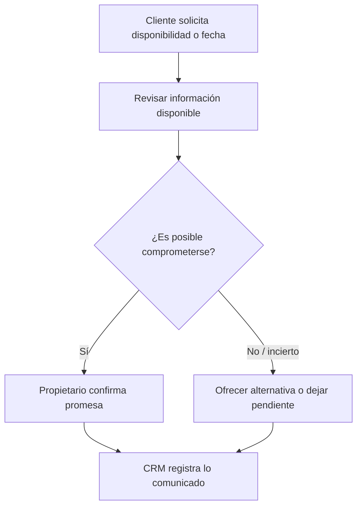

# Decisiones comerciales y responsabilidades

**Proyecto:** Ferre & Inversiones MIGAL  
**Incremento:** PC2 v2.1  
**Alcance:** decisiones comerciales previas al pedido confirmado

## 1. Propósito

Explicar quién decide, con qué información y qué evidencia debería conservarse para tres decisiones relevantes del escenario comercial de MIGAL:

1. descuento excepcional;
2. disponibilidad o promesa al cliente;
3. condición de facturación.

El documento distingue el **contexto comercial que conserva el CRM** de los **compromisos y ejecución que posteriormente corresponden al ERP u otros sistemas**.

## 2. Matriz resumen

| Decisión | AS-IS en MIGAL | Responsable principal actual | Evidencia TO-BE esperada | Límite CRM–ERP |
|---|---|---|---|---|
| Descuento excepcional | No existe porcentaje máximo formal; el ajuste puede materializarse como menor precio unitario | Dueña o dueño | Precio de referencia, precio ofrecido, motivo, autorizador y fecha | CRM conserva contexto y aprobación; no define una política técnica de precios |
| Promesa al cliente | Se evalúa según producto, stock conocido, proveedor, ubicación, carga y agenda de entregas | Dueña o dueño | Qué se promete, cantidad/fecha, responsable y condición relevante | CRM registra la promesa comunicada; disponibilidad y ejecución pertenecen al ERP/operación |
| Condición de facturación | Cliente comunica si requiere boleta o factura; KeyFacil es operado por los propietarios | Dueña o dueño | Tipo de comprobante previsto y datos fiscales pendientes/disponibles | CRM conserva la condición acordada; emisión del comprobante queda fuera de PC2 |

## 3. Descuento excepcional

### 3.1. Evidencia AS-IS

- `[E][AS-IS]` La determinación del precio toma como referencia costos recientes, tipo de producto, mercado y características de la operación. `[FN-01]`
- `[E][AS-IS]` Los descuentos consideran cantidad, relación con el cliente, mezcla de productos, condiciones de reparto y conveniencia comercial. `[FN-01][FN-02]`
- `[E][AS-IS]` No existe un porcentaje máximo formalizado. `[FN-01]`
- `[E][AS-IS]` Ambos propietarios pueden autorizar ajustes. `[FN-01][FN-02]`
- `[E][AS-IS]` El descuento puede quedar implícito al reducir el precio unitario, sin registrarse como un campo separado. `[FN-02]`
- `[E][AS-IS]` Los clientes pueden presentar precios de otras ferreterías; la propietaria procura conservar un precio competitivo sin comprometer la rentabilidad. `[FN-02]`

### 3.2. Mejora propuesta

`[TO-BE]` Cuando se modifique un precio por negociación o excepción, registrar como mínimo:

- precio de referencia utilizado;
- precio finalmente ofrecido;
- diferencia concedida;
- motivo del ajuste;
- persona que autorizó;
- fecha de decisión;
- versión de cotización afectada.

Esta propuesta **no establece un límite fijo de 5 %, 10 % u otro valor**, porque no existe evidencia de una política formal de ese tipo en MIGAL.

### 3.3. Evidencia esperada

La evidencia no necesita ser una firma digital compleja. Para PC2 basta con que el escenario muestre que la decisión puede reconstruirse:

> Cotización COT-XXX-V02 · línea de producto · precio de referencia · precio concedido · motivo “competencia” · autorizado por propietaria/dueño · fecha.

## 4. Disponibilidad y promesa al cliente

### 4.1. Evidencia AS-IS

`[E][AS-IS]` La posibilidad de conseguir o entregar un material depende del tipo de producto y de las condiciones de la operación. Pueden influir:

- existencia conocida;
- posibilidad de reposición con proveedor;
- disponibilidad del producto en proveedor;
- ubicación del cliente;
- carga del pedido;
- cantidad y tipo de material;
- disponibilidad de vehículos y personal;
- saturación de entregas ya comprometidas.

Ambos propietarios pueden tomar la decisión. `[FN-01][FN-02]`

### 4.2. Mejora propuesta

Antes de comunicar una promesa concreta se propone dejar constancia de:

- producto/cantidad relevante;
- fecha o condición prometida;
- responsable que confirmó;
- fundamento operativo disponible al momento de decidir;
- observación si la promesa depende de proveedor u otra condición.

### 4.3. Frontera conceptual

- **CRM:** conserva lo solicitado, la conversación, la promesa comunicada, el responsable y el próximo paso.
- **ERP / operación posterior:** confirma y ejecuta disponibilidad, reservas, abastecimiento, despacho y entrega.

La PC2 no diseña la integración técnica entre ambos.

## 5. Condición de facturación

### 5.1. Evidencia AS-IS

- `[E][AS-IS]` KeyFacil es utilizado por la dueña y el dueño para la emisión de comprobantes; los trabajadores no realizan esta actividad. `[FN-02]`
- `[E][AS-IS]` El cliente comunica si requiere boleta o factura. `[FN-02]`
- `[E][AS-IS]` En la práctica descrita por MIGAL se solicita DNI o RUC según el comprobante requerido. `[FN-02]`

### 5.2. Mejora propuesta dentro del alcance PC2

El CRM puede conservar **la condición comercial acordada**, por ejemplo:

- comprobante previsto: boleta / factura / por definir;
- información fiscal disponible: sí/no;
- responsable de completar la información;
- observación relevante.

No se diseña ni ejecuta la factura en PC2.

## 6. Principio común de responsabilidad

`[I]` MIGAL no presenta departamentos separados de ventas, logística y finanzas; los propietarios concentran varias responsabilidades. Por ello, la propuesta debe evitar inventar cargos organizacionales inexistentes como “jefatura comercial” o “finanzas” para describir el AS-IS.

En el TO-BE pueden definirse responsabilidades funcionales, pero deben mapearse a personas o roles reales de la empresa.

## 7. Límites y pendientes

- `[ND]` No existe aún una política formal aprobada que determine qué descuentos pueden resolver los trabajadores sin escalar.
- `[ND]` No existe una matriz formal de capacidad logística para promesas.
- `[ND]` No se define en PC2 la lógica técnica de validación de disponibilidad.
- Pedido, reserva, entrega y emisión del comprobante quedan fuera del alcance evaluable actual.

---

## 8. Catálogo Central de Reglas de Negocio Previas al Pedido (Matriz RN)

> Matriz asociada en formato Excel: [`reglas-negocio.xlsx`](reglas-negocio.xlsx)

Este catálogo unifica las directrices operativas que gobiernan el Escenario A (`marketing → cotización`) en Ferre & Inversiones MIGAL antes de la generación del pedido.

| ID | Regla de Negocio | Etapa | Motivo de negocio (Por qué) | Sistema (Validador) | Control (CT) | ¿Qué pasa si se viola? (Consecuencia) | Responsable / Rol |
| :--- | :--- | :--- | :--- | :--- | :--- | :--- | :--- |
| **RN-01** | **Control de Duplicados:** Un cliente o "lead" no puede registrarse dos veces con el mismo celular o nombre clave. | ETP-01: Nuevo | Evitar bases de datos sucias y que dos vendedores atiendan al mismo cliente ofreciendo condiciones distintas. | CRM | CT-01 | Sistema advierte coincidencia y sugiere fusionar con la ficha existente. | Vendedor |
| **RN-02** | **Próxima Acción Obligatoria:** Toda Oportunidad perfilada debe tener asignada una fecha o tarea de seguimiento. | ETP-02: Calificado | Evitar que las obras o ventas importantes "se enfríen" por olvido del vendedor. | CRM | CT-02 | El sistema marca la oportunidad en alerta de abandono tras permanecer sin seguimiento programado. | Vendedor |
| **RN-03** | **Precios de Lista Vigente:** Los precios unitarios en la cotización deben extraerse de la base de datos y están sujetos a actualización mientras no exista un pago o confirmación formal. | ETP-03: Propuesta | Proteger el margen frente a la volatilidad del costo de agregados y fierros. | ERP | CT-03 | El sistema obliga a actualizar precios si cambian los costos antes de la confirmación/pago. | Sistema ERP / Propietarios |
| **RN-04** | **Versionado de Cotizaciones:** Si el cliente solicita cambios en cantidades o productos tras recibir una proforma, se crea una nueva "versión" de la cotización, sin sobrescribir ni eliminar la original. | ETP-03: Propuesta | Mantener un historial auditable de la negociación para entender qué productos descartó el cliente. | ERP/CRM | CT-04 | Imposibilidad de eliminar cotizaciones enviadas; solo se permite "Clonar/Versionar". | Vendedor |
| **RN-05** | **Promesa de Disponibilidad:** Solo el personal autorizado (Ventas/Propietario) puede confirmar al cliente la disponibilidad física de un material crítico (ej. Cemento) basándose en la consulta del sistema y condiciones operativas. | ETP-03: Propuesta | Evitar que asistentes o personal no autorizado prometan despachos imposibles de cumplir. | CRM/ERP | CT-05 | Restricción de compromiso de entrega según el rol del usuario. | Vendedor / Propietario |
| **RN-06** | **Condición de Facturación Prevista:** Antes de emitir la cotización, se debe consultar si la eventual compra requerirá Boleta o Factura (aunque no se exija RUC en ese instante). | ETP-03: Propuesta | Preparar administrativamente el cierre del pedido y anticipar si se tratará de una cuenta empresa o persona natural. | CRM | CT-06 | Campo "Tipo de Comprobante Esperado" registrado como `Boleta`, `Factura` o `Por Definir`. | Vendedor |

---

## 9. Catálogo de Excepciones y Tratamiento Operativo (Matriz EXC)

| ID | Excepción (Incidencia) | Tratamiento Propuesto (Cómo se resuelve) | Acción en Sistema |
| :--- | :--- | :--- | :--- |
| **EXC-01** | **Excepción de Descuento (Igualar competencia):** Cliente demuestra que otra ferretería tiene un precio menor en un material clave. | La decisión recae exclusivamente en los propietarios. Si el volumen justifica el sacrificio de margen, se aprueba el descuento extraordinario. | Propietario aprueba la excepción en el sistema, generando nueva versión y dejando traza de su usuario. |
| **EXC-02** | **Sin Stock por Desfase (Inventario Fantasma):** El sistema muestra stock para cotizar, pero el vendedor sabe (por conocimiento físico) que el producto está dañado o no hay la cantidad suficiente. | El vendedor no compromete el producto faltante, notifica la discrepancia a almacén y ofrece un sustituto o deja pendiente en la proforma. | Se registra la observación y se levanta alerta de "Ajuste de Inventario" en el ERP. |

---

## 10. Matriz de Trazabilidad (Reglas ↔ Documentos)

| Regla / Excepción | Documento Origen / Relación | Documentos que la consumen (Trazabilidad) |
| :--- | :--- | :--- |
| `RN-01`, `RN-02` | Nace en el [escenario CRM](escenario-crm.md) / [lead, oportunidad y cotización](lead-oportunidad-cotizacion.md) | [INT-01](../../arquitectura/integraciones/INT-01-CRM-ERP.md) / [Plan de trazabilidad](../../datos/trazabilidad/plan-trazabilidad-auditoria.md) (`TR-01`, `TR-02`) |
| `RN-03` a `RN-06` | Nace en el [escenario CRM](escenario-crm.md) y en este documento | [INT-01](../../arquitectura/integraciones/INT-01-CRM-ERP.md) / [Plan de trazabilidad](../../datos/trazabilidad/plan-trazabilidad-auditoria.md) (`TR-03`) / [Caso normal](caso-normal.md) (`CP-01`) |
| `EXC-01` | Excepción Comercial ([`caso-excepcion.md`](caso-excepcion.md)) | [Modelo de autorización](../../arquitectura/seguridad/modelo-autorizacion.md) (`SOD-01`) / [Plan de trazabilidad](../../datos/trazabilidad/plan-trazabilidad-auditoria.md) (`TR-04`) / [Caso de excepción](caso-excepcion.md) (`CP-02`) |
| `EXC-02` | Excepción Operativa | [Modelo de autorización](../../arquitectura/seguridad/modelo-autorizacion.md) (`SOD-03`) / [Caso de excepción](caso-excepcion.md) (`CP-02`) |

---

## 11. Análisis del Impacto del Sistema

**Cómo inciden el ERP y CRM en la operación:** El establecimiento de estas reglas demuestra que la operación de Ferre & Inversiones MIGAL requiere de controles que no pueden sostenerse únicamente en la memoria. Reglas como la `RN-03` evidencian que extraer los precios desde una base de datos central (ERP) mitiga el riesgo de cotizar a pérdida debido a la volatilidad de los materiales de construcción. Por su parte, la aplicación de la `RN-02` (seguimiento) y `RN-04` (versionado) en un entorno CRM permite formalizar la gestión comercial con maestros de obra y cuentas clave, pasando de acuerdos verbales informales a historiales documentados y trazables, lo cual otorga visibilidad estructurada al esfuerzo de ventas previo a la confirmación de cualquier pedido.
