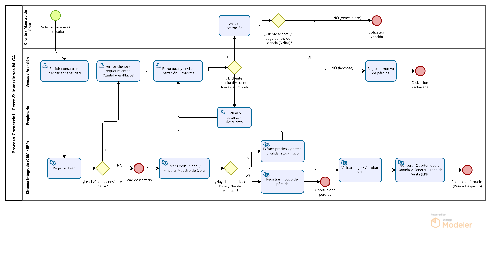

# Escenario comercial: flujo marketing → lead → oportunidad → cotización

**Proyecto:** Ferre & Inversiones MIGAL  
**Incremento:** PC2 v2.1  
**Responsable:** Alejandro Flores  
**Alcance:** Flujo comercial previo al pedido confirmado (`ETP-01` a `ETP-03`)

## 1. Contexto y Canales Reales de Captación

Actualmente, el proceso de venta en Ferre & Inversiones MIGAL depende casi en su totalidad de la memoria y gestión manual de los propietarios. Los pedidos ingresan de manera desordenada y la priorización es empírica.

Los canales de captación identificados en el negocio son (ver detalle de cuentas y contactos en [`cuenta-contacto-canales.md`](cuenta-contacto-canales.md)):

- **Mostrador / Presencial `[E][H]`:** Tráfico natural de clientes y maestros de obra que visitan la ferretería.
- **WhatsApp `[E][H]`:** Canal de alta rotación para consultas rápidas, envío de listas de materiales y coordinación con maestros de obra.
- **Llamadas telefónicas `[E][H]`:** Principalmente usado para clientes de obras en curso que necesitan reposición urgente.
- **Recomendación de Maestro de Obra (Boca a boca) `[E][H]`:** Canal habitual de referidos. `[I]` Se interpreta que este canal podría generar mayor fidelización y tickets más altos, aunque actualmente no existe una medición objetiva ni data histórica que lo confirme como un hecho.
- **Campañas puntuales / Folletos de Progresol `[S]`:** Canal supuesto basado en la distribución física ocasional de material publicitario brindado por la marca Progresol, en lugar de un "volanteo" constante. Al registrar en el CRM la ubicación de los prospectos captados en estas campañas específicas, se podrá perfilar la cobertura territorial de la ferretería.

---

## 2. Diagrama del Proceso Comercial (BPMN)

- **Archivo fuente editable:** [`fuentes/flujo-comercial.bpm`](fuentes/flujo-comercial.bpm)
- **Render del diagrama:**

---

## 3. Fichas por Etapa del Flujo Comercial (Nomenclatura Odoo)

El detalle de los atributos comerciales de cada etapa se complementa en [`lead-oportunidad-cotizacion.md`](lead-oportunidad-cotizacion.md).

### ETP-01: Nuevo (Lead)
- **Qué ocurre:** Recepción de un primer contacto, consulta o lista de materiales por cualquiera de los canales.
- **Quién lo hace:** Atención al cliente / Vendedor / Propietario.
- **En qué sistema:** Módulo CRM (Odoo).
- **Datos que entran:** Nombre (o alias), teléfono, **fuente** (canal de origen) y registro de la **interacción** inicial (necesidad consultada).
- **Datos que salen:** Registro del Lead en el sistema con un identificador único.
- **Por qué existe y comparativa AS-IS:** En la actualidad, las consultas por WhatsApp o mostrador que no se cierran de inmediato se pierden. Esta etapa existe para centralizar todas las intenciones de compra en una sola bandeja.

### ETP-02: Calificado (Oportunidad)
- **Qué ocurre:** Se perfila el lead para determinar la envergadura del requerimiento y se estructura la información comercial clave antes de cotizar.
- **Quién lo hace:** Vendedor.
- **En qué sistema:** Módulo CRM (Odoo).
- **Datos que entran:** Diferenciación entre **cuenta vs. contacto** (empresa/obra vs. persona que compra), identificación de roles (**dueño de obra vs. maestro de obra**), ubicación física (**obra/dirección**), programación de la **próxima acción** de seguimiento y asignación de una **probabilidad (Baja/Media/Alta)** de cierre.
- **Datos que salen:** Oportunidad perfilada y asignada a un responsable comercial.
- **Por qué existe y comparativa AS-IS:** Hoy, el negocio no clasifica a sus prospectos. Esta etapa permite priorizar el esfuerzo comercial, separando las ventas rápidas de las oportunidades estratégicas que requieren seguimiento y evaluación de probabilidad.

### ETP-03: Propuesta (Cotización)
- **Qué ocurre:** Se elabora un documento formal (proforma) con los precios de los materiales requeridos y se registra el desenlace comercial de dicha propuesta.
- **Quién lo hace:** Vendedor.
- **En qué sistema:** Interfaz CRM – ERP (Módulo de Ventas).
- **Datos que entran:** Lista de productos, precios extraídos del sistema, **competencia** referenciada (si el cliente menciona ofertas de otras ferreterías).
- **Datos que salen:** Documento de cotización versionado enviado al cliente y evaluación del **resultado: Ganada total, Ganada parcial o Perdida**.
- **Por qué existe y comparativa AS-IS:** Actualmente, los precios de venta y los márgenes de ganancia (que varían según la línea de producto) están en la cabeza de una sola persona, generando el riesgo de cotizar a pérdida si ocurre un error. Esta etapa democratiza la capacidad de cotizar apoyándose en el sistema, incluso si el cliente aún no desea dejar su nombre completo.

---

## 4. Reglas de Salto

### Regla de salto 1: Lead → Oportunidad (Calificación)
- **Condición:** Necesidad concreta declarada, decisor y roles mapeados (diferenciando si quien cotiza es el dueño de la obra o el maestro), e identificación de la cuenta/contacto.
- **Quién la valida:** Vendedor (check manual o avance en el pipeline del CRM).
- **Dónde queda el registro:** En la ficha de la oportunidad en el CRM.
- **Qué ocurre si no se cumple:** El registro permanece bloqueado en la columna "Nuevo" o es trasladado a "Lead Descartado".

### Regla de salto 2: Oportunidad → Cotización (Validación y Precios)
- **Condición:** Los precios deben ser extraídos de la lista vigente del ERP y se debe consultar la disponibilidad física (almacenes). *Nota de negocio: Actualmente es posible y válido emitir cotizaciones sin que el cliente entregue su nombre completo o DNI/RUC, por lo que la identificación formal NO es obligatoria para saltar a esta etapa*.
- **Quién la valida:** Sistema ERP (Validación automática de origen del precio y stock) / Propietarios.
- **Dónde queda el registro:** En el borrador de la cotización generada.
- **Qué ocurre si no se cumple:** El botón de "Generar Cotización" bloquea la inclusión de productos sin precio o sin stock verificado.

---

## 5. Salidas y Excepciones

El flujo comercial contempla qué sucede en el desenlace de la cotización o cuando las ventas no avanzan:

- **Lead descartado:** Ocurre cuando el contacto es inválido; los datos se archivan sin crear cuenta de cliente para no ensuciar el ERP.
- **Resultado de Cotización:** Una vez enviada la proforma, se clasifica el resultado en **Ganada total** (acepta todo), **Ganada parcial** (compra solo parte de la lista en MIGAL y el resto en otra ferretería), o **Perdida**.
- **Oportunidad perdida:** Si el resultado es una pérdida, es obligatorio registrar el motivo y anotar a la **competencia** (si se conoce quién se llevó la venta) para analizar la competitividad territorial.
- **Cotización vencida / sujeta a actualización:** Por la volatilidad de materiales, las proformas no tienen una vigencia fija inmutable; mientras no exista confirmación o pago, el precio está sujeto a actualización si cambian los costos del proveedor, generando una nueva versión.

---

## 6. Justificación del ERP/CRM

**Por qué esto justifica el ERP y CRM:** El análisis de la situación actual (AS-IS) de Ferre & Inversiones MIGAL demuestra que la alta dependencia en la memoria de una sola propietaria para conocer precios y márgenes cruzados representa un riesgo crítico que limita la escalabilidad del negocio. Implementar este flujo estandarizado (TO-BE) a través de un CRM interconectado con un ERP justifica su inversión porque permite dar trazabilidad a las interacciones multicanal, ayuda a medir las probabilidades de cierre y la competencia, y democratiza la capacidad de cotizar de forma segura sin exigir fricciones innecesarias al cliente (como el DNI obligatorio), al mismo tiempo que apoya en el sistema, y no únicamente en la memoria humana, la consulta de precios vigentes.