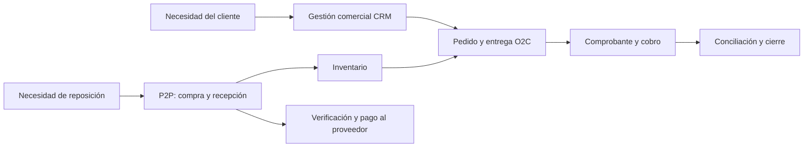

# Mapa de procesos de nivel 1

**Estado:** clasificación TO-BE propuesta; no acredita departamentos formales ni procesos aprobados. Fuente de contexto: [FN-01/FN-02](../../fuentes/fuentes-negocio.md).

## Procesos y propósito

| Grupo | Proceso funcional | Entrada → salida | Responsabilidad funcional |
|---|---|---|---|
| Dirección | Planificación comercial y decisiones del negocio | Necesidades/resultados → prioridades y condiciones | Propietarios |
| Core | Gestión comercial CRM | Consulta → propuesta y seguimiento | Atención / propietarios |
| Core | Order to Cash | Necesidad comercial → entrega, cobro y cierre/excepción | Atención, almacén y propietarios según función |
| Core | Procure to Pay | Necesidad de reposición → recepción y pago conciliado | Propietarios, almacén y administración funcional |
| Core compartido | Gestión de inventario | Recepciones, salidas y conteos → existencias y diferencias trazables | Personal operativo / propietarios |
| Soporte | Registro económico y conciliación | Operaciones/comprobantes → saldos y conciliaciones | Propietarios y apoyo contable según función validada |
| Soporte | Datos, accesos y continuidad | Necesidades de información/acceso → registros confiables y servicio recuperable | Propietarios; soporte técnico por definir |

La agrupación es analítica. Una misma persona puede ejecutar varias funciones; el [modelo de autorización](../../arquitectura/seguridad/modelo-autorizacion.md) propone controles sobre operaciones incompatibles. Inventario conecta ventas y abastecimiento, pero no reemplaza P2P. CRM es el tramo comercial de entrada a O2C, no un segundo proceso de venta desconectado.

## Corte académico y coordinación

PC2 analiza consulta, cuenta/contacto, oportunidad, cotización y decisiones previas al pedido. O2C completo, P2P, inventario y cierre económico son diseño acumulativo/futuro sujeto a requisitos EP. Este mapa no prueba integración técnica ni exige instalar Compras.

## Puntos de control compartidos

- Misma identidad de producto y unidad entre oferta, abastecimiento y movimiento.
- Aceptación y autorizaciones documentadas antes de compromisos que las requieran.
- Diferencias de recepción/entrega visibles, sin ajustar silenciosamente cantidades.
- Comprobantes y pagos separados de documentos operativos y conciliados por referencia.

## Pendientes de validación

Revisar con Procesos la clasificación, puntos de inicio/fin y tareas reales; mapear funciones a personas; confirmar requisitos EP. Véanse [O2C](../o2c/sipoc.md), [P2P](../p2p/sipoc.md), [inventario](../inventario/flujo.md) y [alcance](../../arquitectura/base/alcance.md).
